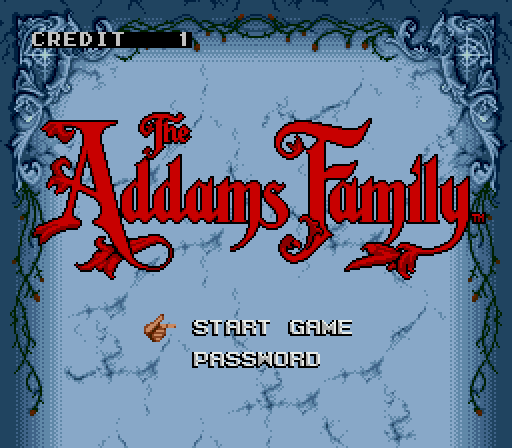
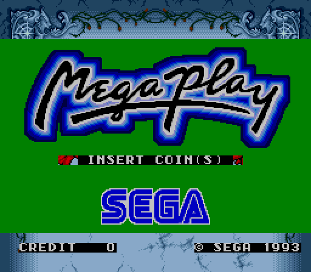
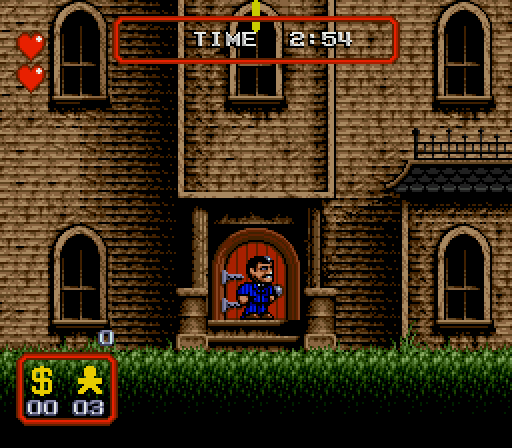
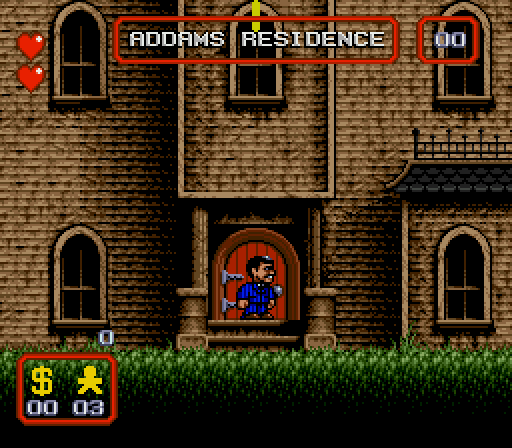

<div align="center">

# 🕯️ The Addams Family ARCADE — Mega Play Edition

### The first new game for the Sega Mega Play in 33 years.

**1993 hardware · 2026 release · insert coin**



</div>

---

The arcade version of **The Addams Family** has been converted to run on the
**Sega Mega Play**, Sega's 1993 coin-op board built on Mega Drive hardware.
It now sits alongside Streets of Rage II, Sonic and the rest of the original
lineup.

Coins, credits and game settings now come from the Mega Play BIOS and its DIP
switches. High scores are saved in the board's battery-backed RAM. Continues
and password refunds are charged and returned correctly, and the BIOS overlay
sits in its own corner so it stays out of the game.

It plays in the **mame2003-plus** libretro core with the `mp_addams` driver.
The set is built from your own original cartridge ROM and `mp_sor2.zip` with
the IPS patches and the script in this repository.
**No ROMs and no Sega code are distributed.**

<div align="center">



</div>

## ✨ What you get

- 🪙 **A real Mega Play game.** It talks to the BIOS over the board's own
  serial protocol, just like Sega's titles. The BIOS counts the coins, draws
  INSERT COIN / CREDIT and runs its attract pages between plays.
- 🎮 **Arcade rules.** A credit starts a game. A coin during the countdown
  continues in the room where you died. In-game, the counter blinks when you
  run out.
- 🔑 **Fair passwords.** A password costs a credit; a wrong one gives it back.
- 🏆 **Persistent high scores.** The table lives in the BIOS battery RAM, so
  records survive power cycles.
- 🎛️ **Hardware DIP switches.** The service menu is replaced by DSW C:
  extra-life pickups and lives per credit. Coinage and free play come from the
  BIOS DIPs, as on every Mega Play game.
- 🧩 **Clean overlay.** The BIOS lines move to the top-left of the screen, clear
  of the menu and the high-score table.

## 🛠️ Build the ROM set

### You need

| What | Details |
|---|---|
| Original cartridge ROM | *The Addams Family (USA, Europe)*, Mega Drive / Genesis, 1 MB headerless. CRC32 `71F58614`, MD5 `eba5f964addea18b70336d292a08698d`, SHA-1 `1cd7ac493a448c7486eefde2300240c3675986a9`. A 512-byte copier header is removed automatically. |
| `mp_sor2.zip` | The MAME set of *Streets of Rage II* (Mega Play): `mpr-15425.ic1` (CRC32 `CD6376AF`) and `epr-15175-05.ic2` (CRC32 `1DF5347C`). Files are matched by CRC, so the names inside the zip don't matter. |
| `megaplay.zip` | The standard Mega Play BIOS set, unchanged. |
| Python 3 | Any 3.x, standard library only. |

### One command

```sh
git clone https://github.com/zanac/The-Addams-Family-Mega-Play-Arcade
cd The-Addams-Family-Mega-Play-Arcade
python3 make_mp_addams.py "Addams Family, The (USA, Europe).md" path/to/mp_sor2.zip out
```

Result: `out/mp_addams.zip`

| File | Size | CRC32 | SHA-1 |
|---|---|---|---|
| `epr-26013.ic1` — game ROM, word-swapped | 2 MB | `87ecace1` | `d6529b4b692a9515ccf6722f26c011660154ae7a` |
| `epr-15175-20.ic2` — instruction ROM | 32 KB | `dcfde4e7` | `3f5a1b4de94fad4ccd404b95a53fdb2e1c4773e6` |

The script checks every input and output CRC and stops with a clear message
if anything doesn't match.

### Why a script and not only an IPS?

A Mega Play game needs Sega's BIOS link routines and an instruction ROM in
Sega's format. Neither can be redistributed, so both are taken from **your**
`mp_sor2.zip`:

- `patches/mp_addams_game.ips` turns the original ROM into the 2 MB Mega Play
  game ROM, minus the BIOS link routines (`0x110000-0x110597`, left as zeros);
- `patches/mp_addams_info.ips` turns SOR2's `epr-15175-05.ic2` into
  `epr-15175-20.ic2` (title, instruction text, DIP labels, Z80 handlers);
- `make_mp_addams.py` applies both, copies and relocates the link routines
  from SOR2, word-swaps the game ROM as MAME expects, and writes the zip.

The IPS files are standard, but a game ROM patched by hand stays incomplete
until the script fills that range in.

## 🕹️ Play it

1. **Get a core with the driver.** Build the `mp_addams` branch of
   [zanac/mame2003-plus-libretro](https://github.com/zanac/mame2003-plus-libretro/tree/mp_addams):
   ```sh
   git clone -b mp_addams https://github.com/zanac/mame2003-plus-libretro
   cd mame2003-plus-libretro && make
   ```
   Or apply [`core/0001-Add-mp_addams-…patch`](core/) to your own tree with
   `git am`.
2. Put `mp_addams.zip` and `megaplay.zip` in the same ROM folder.
3. Load `mp_addams.zip`. The BIOS runs its usual boot test on the first start,
   then the Mega Play attract screen appears.

**Controls:** Coin (Select) adds a credit · Start begins or continues


### DIP switches (core menu → Dipswitches)

| Switch | Values |
|---|---|
| 1UP Every (DSW C 1-2) | 3 / 2 / 1 pickups |
| Lives (DSW C 3-4) | 3 / 5 / 7 / 99 |
| Coinage, free play | BIOS DSW A / B |

## 📁 Repository layout

```
make_mp_addams.py        builds mp_addams.zip
patches/                 the two IPS patches
core/                    mame2003-plus driver patch (git am format)
docs/MEGAPLAY_NOTES.md   technical notes: BIOS protocol, hooks, credits, high scores
docs/img/                screenshots
```

## 🔬 Under the hood

The full story is in [`docs/MEGAPLAY_NOTES.md`](docs/MEGAPLAY_NOTES.md). In
short:

- the 68000 game and the BIOS Z80 exchange 16-bit commands over pad port C;
- the arcade credit code is untouched: coins now come from the BIOS count
  instead of the MODE button, and every spent credit is reported back
  (`FF0A` for a new game, a new `FF14` for a continue, `FF15` for a refund);
- the high-score table moves from cartridge SRAM, which the Mega Play doesn't
  have, to the slot's 256-byte area that the BIOS keeps in battery RAM;
- the instruction ROM carries the title, the instruction page, the GAME
  SETTING labels and a few bytes of Z80 code that the BIOS runs for this game.

## ⚖️ Credits and legal

Mega Play conversion by **zanac**, based on *The Addams Family ARCADE* v77.0.

The Addams Family © Acclaim / Flying Edge; the name and characters are
trademarks of Paramount. Mega Play, its BIOS and Streets of Rage II © Sega.
This is a free, non-commercial fan project. It distributes patches only:
please never share the patched ROMs.
